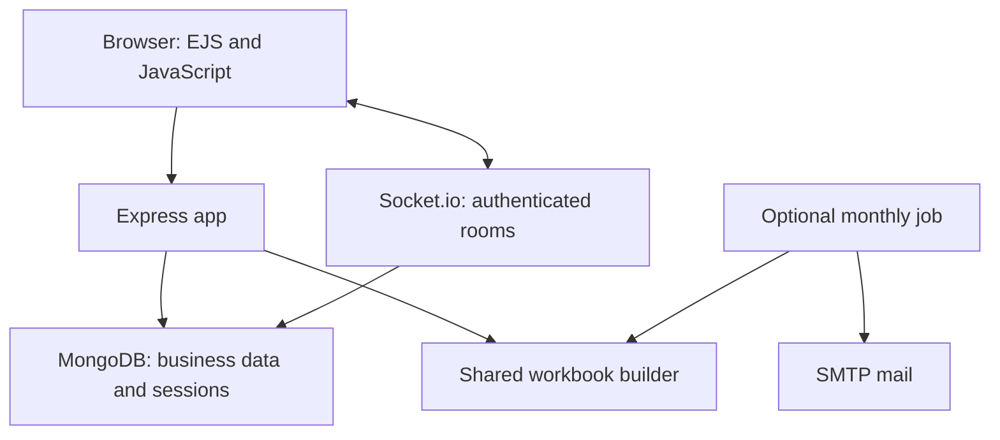

> **Archive:** Preserved for reference. For current paths and commands, use [the documentation index](../README.md).

> **New: local HTTPS support** — See [START_HERE_HTTPS.md](../setup/START_HERE_HTTPS.md) for the exact Mac commands and Google OAuth callback changes, and [docs/HTTPS_SETUP_AND_DEPLOY.md](../setup/HTTPS_SETUP_AND_DEPLOY.md) for production HTTPS through a trusted proxy. Local certificates and secrets are intentionally excluded from the ZIP.

> **Predeployment audit (November 2026):** See [docs/PREDEPLOY_TEST_REPORT.md](../testing/PREDEPLOY_TEST_REPORT.md) for regression fixes, automated test results, and the remaining MongoDB/Chrome/live-Google verification gates.

> **New: Google Sign-In and login-method settings.** See [docs/GOOGLE_LOGIN.md](../setup/GOOGLE_LOGIN.md) for Google Cloud setup, linking Google to an existing account, security controls and verification steps. No user accounts are deleted or reset.

> Latest update: see [docs/RECOVERY_AND_DASHBOARD.md](../features/RECOVERY_AND_DASHBOARD.md) for the glass recovery pages, remembered access, sidebar dashboards and wrong-role guidance.

> **Connected component workspace:** New profile, task calendar/progress, attendance and HR/Manager team creation are available from every dashboard sidebar. See [docs/COMPONENT_WORKSPACE.md](../features/COMPONENT_WORKSPACE.md) for the seven reference mappings, upgrade steps and verification limits.

> Appearance update: start with [docs/PREMIUM_UI.md](../features/PREMIUM_UI.md) for setup, all eight requested changes and verification limits.

> **Liquid Sculpture landing update:** See [docs/LANDING_PAGE.md](../features/LANDING_PAGE.md) for the files and asset folders to copy into your existing project. Keep your `.env`, database and uploads. No new dependencies are required.

# RoleSphere

RoleSphere manages employee attendance, leave, tasks and approvals across Admin, HR, Manager and Employee roles.

Built with Node.js, Express, EJS, compiled Tailwind CSS, MongoDB/Mongoose, Socket.io and Mongo-backed sessions. The browser uses sessions; JWT verification helpers remain available for API integrations. This is an upgrade of the supplied project. Login and registration now use the supplied Glass Folder Cards design; dashboard design work is separate.

## Glass authentication pages

Open `/login` or `/register` for animated glass folders for Admin, HR, Manager and Employee. Open a folder to reveal sign-in and account-creation links, or use the link below it. Each role has a matching frosted-glass form, with responsive mobile layout, password visibility controls, confirmation on registration, loading states and inline errors. Administrator accounts remain provisioned separately.

The visual style and generated canvas artwork are adapted from the Glass Folder Cards component you supplied. The implementation uses EJS, CSS and browser JavaScript, so React, TypeScript, shadcn and new runtime packages are not required. Existing authentication endpoints, session handling, approval rules and dashboards are retained.

## Run locally

Use Node.js 20.19+ and a local MongoDB instance or MongoDB Atlas. Open a terminal in this folder:

```bash
npm ci
cp .env.example .env
node -e "console.log(require('crypto').randomBytes(48).toString('hex'))"
```

Paste independently generated values into `SESSION_SECRET` and `JWT_SECRET` in `.env`. Set `MONGO_URI` to your database. Keep `COOKIE_SECURE=false` for local HTTP. Then:

```bash
npm run build
npm start
```

For local HTTP, leave `COOKIE_SECURE=false`, including if you use `PORT=8001`. The app disables HTTPS upgrade/HSTS headers in that mode. Set `COOKIE_SECURE=true` for an HTTPS deployment.

Open http://localhost:8000. Run `npm run dev` for CSS watching and server reload. Keep the terminal open while using the application.

## Demo data and sign-in

Use a separate database named **rolesphere_demo** before running the seed script. The seed refuses any other database name and replaces sample workflow records only for its known demo accounts.

```dotenv
MONGO_URI=mongodb://127.0.0.1:27017/rolesphere_demo
```

```bash
npm run seed
npm start
```

| Role | Email |
| --- | --- |
| Admin | admin@rolesphere.demo |
| HR | hr1@rolesphere.demo |
| Manager | manager1@rolesphere.demo |
| Employee | employee1@rolesphere.demo |

There is no shared default demo password. Set a unique DEMO_PASSWORD (at least 12 characters) in your local .env before running the seed script. Never publish the value or reuse a production password.

The seed supplies 1 Admin, 2 HR, 3 managers, 20 employees in 4 departments, 60 days of attendance, 80 tasks across all four statuses, 60 leave records, 8 reviews and personal to-dos. Running it again preserves those counts.

## What each role can do

| Role | Existing workflows and new capabilities |
| --- | --- |
| Admin | Approve users, manage HR/managers/employees, announcements, leave decisions, exports, company analytics, people directory, organization chart, audit activity |
| HR | Employee management, manager task assignments, HR leave, complaints, transfers after manager approval, exports, analytics, directory and organization chart |
| Manager | Manage their team, assign and review tasks, attendance, work reports, leave decisions, performance reviews, transfer recommendations, task Kanban |
| Employee | Own attendance/profile/tasks/reports/leave/reviews, transfer requests, complaints and personal to-dos; personal three-column board |

Each dashboard has a **Workspace** link. The new feature pages live at `/workspace` and retain simple functional styling until the design phase. **Ctrl+K** (or Cmd+K on macOS) opens a keyboard-navigable search palette. Search scope follows the current role and team.

Managers can move a **Submitted** task to **Approved** or **Rejected**. Employees submit only their own **Pending** tasks. The personal to-do board supports **Pending → In Progress → Done**, with moves in either direction. Cards also have buttons for keyboard use.

## Architecture



`app.js` exports `createApp({ store })` and does not connect or listen on import. `server.js` validates environment, connects MongoDB, creates the HTTP/Socket.io server and starts optional scheduled jobs. Report exports and monthly mail share the summary builder in `backend/services/reportBuilder.js`.

## API additions

| Endpoint | Access | Purpose |
| --- | --- | --- |
| GET /api/analytics/attendance-trend | Admin, HR | Thirty days of present/late counts, including zero days |
| GET /api/analytics/task-status | Admin, HR | Four status counts |
| GET /api/analytics/leave-by-month?year=2030 | Admin, HR | Working leave days split by calendar month |
| GET /api/analytics/dept-headcount | Admin, HR | Approved employees, with empty departments grouped as Unassigned |
| GET /api/search?q=... | Signed in | Literal, bounded search by role and ownership |
| GET /api/activity?action=login.success | Admin | Paginated and filtered audit log |
| GET /api/people/employees, /managers, /hrs | Admin, HR; manager team only | People lists with page, limit, q, status and allowed sort fields |
| GET /api/people/org | Admin, HR | Organization tree and unassigned employees |
| GET /api/board/tasks | Manager, Employee | Scoped, paginated task cards |
| PATCH /manager/tasks/:id/status | Manager | Shared validated task-review handler |
| GET /api/board/todos | Employee | Own paginated to-dos |
| PATCH /api/board/todos/:id/status | Employee | Own board moves |
| GET /healthz, /readyz | Public | Process health and MongoDB readiness |

New list APIs return `{ success, data, total, page, limit }`, default 20, maximum 50. Legacy list endpoints also accept explicit paging/filter/sort parameters and return the envelope plus their old list key. Calls without paging retain their original payload shape; migrating legacy table controls belongs with the next UI pass. All new people and activity tables use server pagination now.

## Security and behavior changes

- Original `.env`, personal uploads, dependency folders and OS metadata are excluded from this deliverable. A clean `.env.example` and empty upload folders are supplied. **Rotate the old MongoDB password, SMTP app password, session secret and JWT secret**; deleting the local file cannot invalidate exposed credentials or erase old Git history.
- One canonical login serves all five login URLs, applies the same rate limit, regenerates the session and stores only a safe actor object. No password hashes are sent by normal model queries or employee JSON APIs.
- Role guards cover legacy routes. Attendance writes derive ownership from the session. Employee email-based reads, team tasks, performance reads, leave decisions and transfer decisions check ownership.
- Transfer assignment requires the current manager's approval and an approved, different destination manager. A repeated decision cannot simply reuse the old transfer.
- Shared express-validator checks cover write requests, including parsed multipart fields. They check scalar types, field lengths, dates, IDs and allowed statuses; Mongo operator-shaped input is rejected.
- Attendance date, clock, Sunday and late cutoff use Asia/Kolkata, independent of the server's timezone. Leave working-day arithmetic uses UTC date-only values.
- Shared `escapeHtml`, explicit escaped template properties, safe JSON script serialization and local DOMPurify sanitization protect legacy HTML rendering paths. Inline event attributes were migrated to delegated listeners and CSP blocks them. Inline script blocks still exist; a nonce-based CSP and full script extraction remain for the layout refactor.
- Destructive administrator delete actions now use POST forms. Logout remains a GET for compatibility and clears the Mongo session and browser session cookie. Session cookies use httpOnly and sameSite=lax. Browser write requests are additionally rejected when the Origin differs from this server origin; full CSRF token coverage is still recommended before public deployment.
- Audit records include login success/failure, password changes/reset, user approvals/rejections, leave decisions, transfer decisions, removals and successful exports. Audit writes log errors without failing business requests.

## Tests and build

```bash
npm run check
npm run build
npm run test:unit
npm run test:integration       # requires MongoDB test binary
npm run test:e2e              # HTTP + DOM smoke check, mocked database
npm run test:tdd              # regressions developed red -> green
```

Tests start a disposable real MongoDB instance using mongodb-memory-server. The first run may download a MongoDB binary; set `MONGOMS_SYSTEM_BINARY` if you already have a supported binary. The test database never uses the uploaded project's credentials. SMTP calls are mocked in tests.

The included suite checks role boundaries, persistent sessions, task transitions, team and employee isolation, malformed input, leave overlap, transfer approval order, analytics, audit access, Excel/PDF exports, rendered scripts, XSS sinks, India time and seed idempotence. See `docs/VERIFICATION.md` for the actual results and limits of this delivery.

## Deployment

`Dockerfile` has a Node 20 build stage and production stage; `render.yaml` supplies a Render setup, and `.github/workflows/ci.yml` installs, builds, compiles and tests on push/PR. Run a production container with `MONGO_URI`, `SESSION_SECRET`, `JWT_SECRET` and `COOKIE_SECURE=true` over HTTPS. No hosted instance or CI badge is claimed until the project is deployed in your account.

Mount a persistent volume at `/app/uploads` for Docker, or attach a persistent disk covering the upload directory on Render. Without it, uploaded attachments disappear on redeploy. S3/Cloudinary integration is not included.

Optional monthly email is disabled by default. To enable the in-app job, set `ENABLE_MONTHLY_REPORTS=true`, SMTP variables and `MONTHLY_REPORT_TO` to your report recipients. It sends the previous month's summary at **08:00 IST on the first of each month**. Use a single scheduler-enabled instance; sleeping/free web services do not guarantee cron execution. No real mail was sent during this upgrade.

## Next phase

The glass login/register pages are complete. The landing page, shared dashboard layout, dashboard section extraction, consistent dashboard dark mode and other dashboard components remain separate design work. `docs/UPGRADE_CHECKLIST.md` maps the guide to this implementation and separates optional/manual work.


## Google OAuth troubleshooting
Run `npm run doctor:google` after updating `.env`. It safely reports missing or malformed OAuth settings and mismatched localhost ports without printing credentials. See `docs/GOOGLE_LOGIN.md`.
